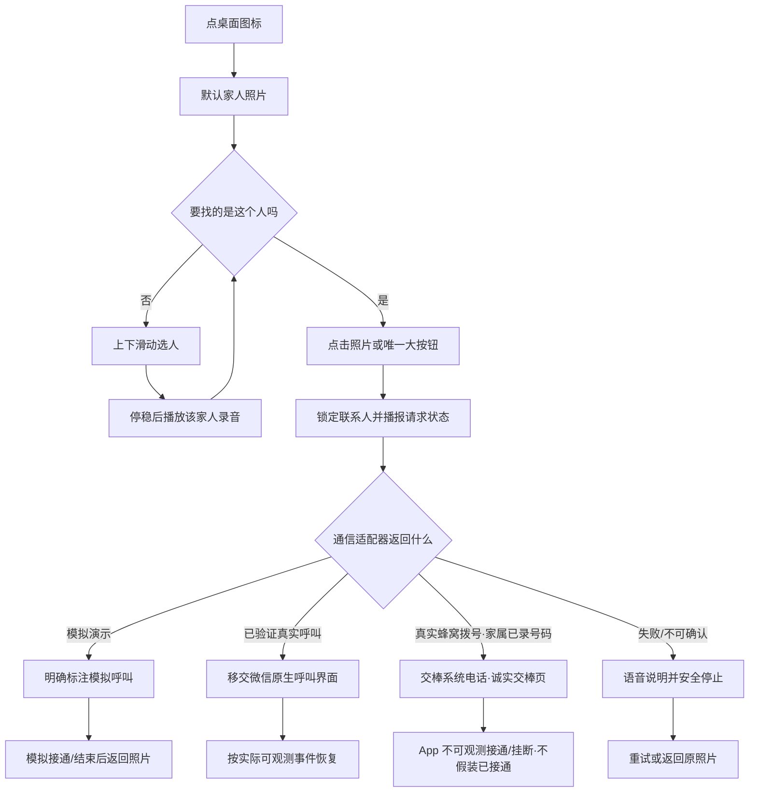
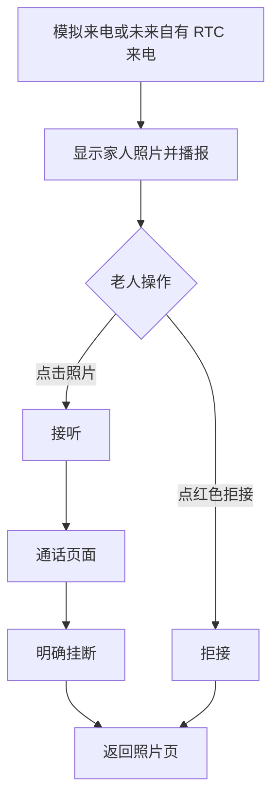

# 常联系｜产品设计文档（PRD）

> 版本：v0.1（首期设计基线）  
> 日期：2026-11-10  
> 定位：公益导向的低识字老人极简亲情通讯工具  
> 主平台：Android 原生 App；家属配置首期在老人手机本地完成  
> 配套文档：[常联系-开发规格-SPEC-v0.1.md](./常联系-开发规格-SPEC-v0.1.md)  
> 状态：待开发；文中“应实现”均为需求，不代表功能已经开发或验证。

## 0. 一页摘要

**产品一句话**：家人提前设置好照片和自己的声音，老人打开「常联系」，上下滑动选择家人，点击大照片即可尝试视频联系；发生问题时，手机用简单的话说清楚发生了什么。

**公益表达**：「想你了，就见一面。」

**真正解决的问题**：一些老人能认出照片、听出熟人的声音，也已经会刷短视频，但不会读联系人姓名、寻找微信聊天对象、记住多步操作。产品减少“辨认目标—选择对象—发起联系”的认知与操作负担。

**首期成功的标准**：不是界面做得多漂亮，而是老人能在没有人站在旁边指导时，找到对的人并完成一次主动联系的操作。真实微信视频发起属于独立技术验证，不能用演示成功冒充真实通话成功。

**产品原则**：一屏一人、家人真人声音、一次明确点击、状态可听、失败能返回、家属做设置。

## 1. 背景、用户与需求边界

### 1.1 核心观察

- 目标老人不能或不愿依赖文字完成操作，但可以**辨认熟悉面孔**。
- 已经熟悉“上下滑动换内容”的单一手势。
- 微信视频操作涉及寻找联系人、理解多个入口、确认操作、处理弹窗和返回路径，容易中断。
- 有时老人必须被动等待家属来电，无法自主发起联系。

以上是**目标用户画像与待验证假设**，不是所有老年人的共同特征。必须用真实用户实验验证“一屏一人＋滑动”是否优于直接点击多个大头像。

### 1.2 目标用户

| 角色 | 能力与情境 | 首要诉求 |
|---|---|---|
| 老人（主要使用者） | 不识字或识字少，视力/听力/精细操作能力可能下降；会点屏幕、上下滑动、认识家人照片 | 不求助，能自主联系家人 |
| 家属（配置者） | 会用智能手机；愿意花几分钟完成设置 | 给老人配置照片、声音和联系对象，以后少做重复指导 |
| 开发与测试人员 | Android 工程人员、公益志愿者 | 低成本、可解释、可测试、可维护 |

**不覆盖的用户**：无法识别照片、严重视觉/听觉障碍、不会任何触摸操作的用户。此类用户可能需要专门的辅助设备或其他交互方式，不能假定本产品适用。

### 1.3 关键用户故事（User Stories）

- US-01：作为老人，我打开应用，立刻看到熟悉的家人照片，不需要认字或选择菜单。
- US-02：作为老人，我滑动到另一张照片，能听到对方自己录制的声音，确认这是我要找的人。
- US-03：作为老人，我点击照片就能发起联系，不用在“视频、语音、聊天”等选项之间决策。
- US-04：作为老人，如果没有打出去、网络断了或者对方没接，我能听懂提示，并且回到刚才那张照片重新尝试。
- US-05：作为家属，我能在首次安装时设置照片、称呼、真人录音、排序和默认联系人。
- US-06：作为家属，我能选择“整张照片点按”或“独立大拨号按钮”，适配不同老人。
- US-07：作为家属，未来可以在自己的设备上远程维护上述配置，但不能未经老人同意开启敏感权限或擅自接听视频。

### 1.4 产品成功指标（设计目标，需实测调整）

| 指标 | 初版目标 | 测量方法 |
|---|---|---|
| 指定联系人识别正确率 | 首轮 5 位目标用户中至少 4 位可在不读字的情况下正确选人 | 每人至少 3 次不同目标选择；记录误选 |
| 首次使用独立完成率 | 至少 4/5 位目标用户经一次简短演示后，可以独立完成“选人→发起” | 不进行途中口头提醒 |
| 误拨率 | 关键测试中 0 次拨向非目标联系人 | 记录触摸与拨号事件；真机测试不接真实陌生号码 |
| 入口到拨号请求时间 | 默认联系人流程目标不超过 15 秒；非默认联系人目标不超过 30 秒 | 真机计时，从点开 App 到发起请求 |
| 异常恢复 | 断网、呼叫失败后，用户能回到熟悉照片页 | 观察是否需要协助 |
| 多日记忆 | 3—7 天后复测，无额外教学可重复操作 | 复测记录 |

这些是**原型验收假设**，并非有研究证明的普遍阈值；如果老人测试结果与指标冲突，应调整产品，不应仅调指标制造“成功”。

## 2. 产品范围与里程碑

### 2.1 范围分级

| 等级 | 交付物 | 必须有 | 不包含 |
|---|---|---|---|
| P0：交互与本地配置可用 | 可安装 Android App；本地配置；清楚标注的模拟通话状态 | 一屏一人、滑动、真人录音、照片点击、语音提示、异常回退、家属本机配置、模拟来电 | 微信真实接入、云端、远程配对、自建 RTC |
| P1：微信拨出验证 | 单一机型／微信版本真机 PoC | 用户明确点击后打开**正确联系人**的视频呼叫；失败安全停止；实际结果记录 | 承诺全机型适用；完全替换微信接听 UI |
| P2：家庭试用 | 真正可持续使用的安装包 | 稳定恢复、实际老人测试、真实设备适配、权限引导 | 大规模推广 |
| P3：家属远程配置 | 家属网页＋可信配置同步 | 绑定、授权、照片/录音同步、配置版本和回滚 | 远程控制敏感权限 |
| P4：自有通话（备选） | 独立视频通信服务 | 我方拨号、来电、接听、挂断全链路 | 默认替代微信；未经评估不启动 |

**范围约束**：本轮正式开发先完成 P0；P1 只做独立可行性研究，不让微信自动化阻塞基本交互。比赛的 Qoder Sites 页面是**公开可用的交互演示**，不等价于 Android APK 或真实微信视频。

### 2.2 明确不做

- 不做 AI 聊天、语音唤醒、语音命令识别和大模型。
- 不做天气、新闻、短视频、紧急救援、健康管理、通讯录全量导入。
- 不做默认桌面替换、锁定系统设置、阻止用户退出或卸载。
- 不做聊天记录读取、屏幕录制、电话录音、定位追踪或广告分析。
- 不做未经用户明确点击的自动拨号；不做默认自动接听视频。
- 不做一般微信用户的联系人信息爬取；不预设存在官方开放的视频呼叫 URI。

## 3. 核心交互原则

### 3.1 “少即是多”的约束

1. 老人端主页**每屏仅一个家人**，不出现顶部导航、底部 Tab、搜索框、菜单、二维码、广告、推荐内容。
2. 默认主要动作只有两个：**上下滑动换家人；点击大照片拨打**。
3. 家人的照片是绝对视觉中心，优先使用本人真实头像或半身照片，不能要求看懂抽象图标。
4. 每当页面稳定在某位家人时，播放这位家人自己录的短音频。滑动过程中禁止连续叠音。
5. 状态必须可听：仅使用少量简单中文短句。失败后页面留在可理解状态，不能突然跳到陌生页面。
6. 给老人看的页面不展示配置选项。家属设置入口隔离，且有明确可恢复的访问方式。
7. 对老人的每一个危险动作采取**失败关闭（fail closed）**：没有确认联系人身份、页面状态或权限，就不要猜测、不要继续点击。
8. 样式宁可普通，也不要华丽；不用多层卡片、浮动工具条、复杂动效、渐变、轮播广告、拟物金属按钮。

### 3.2 基本操作词典

| 动作 | 含义 | 备注 |
|---|---|---|
| 上下滑动 | 换一位家人 | 不能同时用于挂断、设置或确认 |
| 点击照片 | 给当前家人拨打视频 | 默认模式；照片实际命中区域尽可能大 |
| 点击独立大按钮 | 给当前家人拨打视频 | 家属可选模式；照片只用于识别 |
| 点击来电家人照片 | 接听视频 | **仅在我方掌控的来电 UI 中可保证实现**；微信模式不承诺 |
| 点击红色挂断区域 | 结束／拒绝我方通话 | 不能与接听共用同一区域 |
| 重新点击当前照片 | 失败后再次尝试 | 重试前从错误状态安全返回，且应显式显示“再打一次”区域 |

## 4. 老人端界面规范（重点）

### 4.1 全局视觉规范

- 基准：手机竖屏；以 `360dp × 800dp` 作为参考画布，但必须适配小屏、系统字体放大和刘海/状态栏安全区。不要将整个 UI 写死成固定 px。
- 风格：温暖、克制、易辨认。背景建议 `#F7F7F3`，文字 `#1B1B1B`，确认/接听用深绿 `#22754F`，危险/挂断用暗红 `#B43F3B`。
- 字体：系统字体，称呼作为辅助信息可用 28—36sp；状态文字建议至少 22—26sp；在字号放大时不截断关键状态。因为老人可能不识字，文字不是完成流程的唯一依据。
- 图像：清晰真人照片；默认以正方形或竖版裁剪为大幅照片，尽量保留脸部。不用虚构人像、花哨插画代替真实家庭照片。
- 对比度：底部文字覆盖照片时必须有纯色或半透明底板，避免与复杂照片背景混在一起。
- 触控：常规操作目标至少 48dp；老人主要操作面应显著大于此尺度。注意系统边缘返回手势和状态栏不参与呼叫热区。
- 动画：只保留自然换页与状态切换；禁用自动跳转、闪烁、抖动和持续吸引注意的动画。
- 屏幕方向：首版仅竖屏。不得强制打开摄像头或持续占用麦克风。

### 4.2 E00：桌面入口（系统层）

**入口**：手机首页固定常联系 App 图标，优先放在第一屏容易找到的位置；图标建议为朴素的绿色电话／视频图形，名称“常联系”。

**打开后的结果**：直达 E01 默认家人照片（如上次选中对象无效则显示配置的默认联系人）。**禁止打开即自动拨号**。

**首次未配置**：进入独立家属引导页，明确告诉帮助配置的人先设置联系人。不得呈现空白照片页，也不得假装可拨号。

### 4.3 E01：默认／选人页（整个产品最重要的页面）

纯文字空间示意（仅表示层次，不表示真实像素）：

```text
┌──────────────────────────┐
│   [系统状态栏／安全区]     │
│                          │
│                          │
│                          │
│    家 人 的 大 照 片       │
│   （占绝大多数可用空间）   │
│                          │
│                          │
│                          │
│                          │
│                          │
│  [女儿]                  │ ← 字对识字家属有用，老人不用读
│  [小视频图形·点照片联系]  │ ← 非必须的小提示，不做额外菜单
└──────────────────────────┘
```

**视觉与控件**：

- 屏幕主视觉是家人照片，建议占内容区约 75%—90%，随设备长宽比适配。整张照片区域可点击，不要只让脸部圆形头像可点击。
- 照片上仅保留称呼（可选）和一处非常克制的通话含义提示；不显示“设置”“下一位”“上一步”“帮助”“录音”等常驻按钮。
- 若家属选择“独立大按钮”模式，则照片**不响应拨打**，底部显示唯一一枚宽大绿色拨打按钮；需要用不同布局确保其高度足够，不能同时给照片和按钮设置两种拨打入口。
- 如仅有 1 位家人，禁止无效滑动循环；2—5 位家人默认**不循环**，到第一／最后一位时停住，减少迷失。更改此行为应通过用户研究证明必要。
- 固定显示上次成功选中的家人还是默认家人：**首版每次启动使用家属设置的默认家人**，降低不确定性；同一 App 前后台短时切换时保留当前选中对象。

**进入页面的声音**：

1. 某页稳定成为当前页后，等待约 `250—400ms`（初始建议 300ms；验证后调整）。
2. 停止上一位家人的录音并释放旧播放任务。
3. 只播放当前家人的那段录音一次。推荐 3—8 秒，例如：「妈，我是小芳。想找我就点这张照片。」
4. 滑动／拨打／页面离开时立即停止。不能同时播两段。
5. 不要因为重组（Compose recomposition）、横竖屏重建或配置更新就频繁重复播报。
6. 如果录音不可用，应使用简短、明确的备用状态提示，并在家属侧显示需重新录音；不应把错误联系人录音播放到别人的照片页。

**触摸规则**：滑动必须交给 Pager 手势识别；只有稳定页面上的有效点击才能触发拨号。滚动惯性未停止时禁用拨号；双击、长按不得产生两次呼叫。

### 4.4 E02：拨号准备／呼叫中

**触发**：用户明确点击当前家人照片或独立按钮。

- 立即锁定联系人 `contactId`，防止滑动后拨错人。
- 立刻停止家人录音，播放「正在帮你给小芳打电话」或“正在打开电话”，具体词句必须和真实完成阶段一致。
- 主要视觉仍用当前家人照片；覆盖一条简单状态，不新增联系人选择或复杂交互。
- 呼叫未实际验证时，**不能显示「已接通」或「正在视频」**。
- 模拟模式必须在家属／开发环境标记“模拟通话”；对老人演示时亦不能暗示真的打给家人。
- 唯一主要操作：取消本次请求／返回。取消不可误触；若系统跳转到微信且无法安全撤销，语音和 UI 应如实提示当前能力边界。
- **真实蜂窝拨号（P1 回退）**：家属为某家人录入手机号后，点照片可拨**真实蜂窝电话**（默认 `ACTION_CALL` 一键直拨，可改零权限 `ACTION_DIAL` 系统拨号盘）；留空仍纯本地模拟。交棒系统电话后显示诚实交棒页（「正在拨打／已交给系统电话」），**不假装已接通**；号码仅存本机私有配置、绑定 `contactId`，不进日志／仓库／公开演示。失败关闭：号码非法或身份不确定一律不拨。

### 4.5 E03：模拟视频中（P0），真实视频（P4）

- P0 页面用于验证接听／挂断控件布局，不连接真实音视频。
- 以家人照片或明确标注的演示画面占主要区域；只保留底部明显的**红色挂断**操作。
- 不出现聊天、滤镜、切换镜头、屏幕共享等额外按钮。
- 微信实际通话由微信控制界面，P1 **不要求**自行绘制此页，也不假装能够监听所有通话结束事件。

### 4.6 E04：来电接听（模拟与未来自有 RTC）

- 主要视觉为来电家人的照片；语音：「小芳给你打视频电话啦，点一下照片接听。」
- **点照片＝接听**；底部边缘有独立的暗红“挂断／拒接”区域。
- 接听后进入 E03，拒接后返回 E01。不能通过点击同一张照片同时实现接听与挂断。
- 对微信来电：第三方 App **通常无法保证替换微信自身来电 UI**；P0 仅模拟，P1 只在单独真机验证后记录可以实现的部分，不向产品演示者宣称已完全接管微信来电。
- 息屏／锁屏来电属于额外平台约束。未来自有 RTC 才考虑通知和 Android Telecom 接入；不得通过普通 Activity 启动假定能绕过系统限制。

### 4.7 E05：异常页

必须区分：

| 类型 | 老人听到的简短提示 | 行为 |
|---|---|---|
| 网络不可用 |「手机没有网络，暂时打不了电话。」| 停止拨号，保留联系人照片，允许稍后重试 |
| 联系人未正确关联 |「这个电话还没设置好，请让家里人帮忙。」| 禁止猜测拨给其他联系人 |
| 微信未安装或未登录 |「微信现在不能打电话，请让家里人看看。」| 提示家属处理，不循环尝试 |
| 无障碍服务未启用或被系统关闭 |「打电话的功能需要家里人重新设置。」| 不要求老人理解权限界面 |
| 自动化未找到正确目标 |「电话没有打出去，请让家里人检查。」| 安全停止；不得转为随机点击 |
| 对方未接 |「小芳还没接电话，过会儿再试试。」| **仅在能够确认未接时**使用；否则说“没有确认拨通” |
| 音频播放失败 | 不阻断看照片和拨号 | 家属侧记录可理解的配置问题 |

**异常界面规则**：优先保留熟悉的家人照片。只提供“再试一次”和“返回照片”（若返回照片天然可用，可精简为一个按钮）；不会自动连续重拨。错误提示必须有语音，且不得谎报已完成。

### 4.8 E06：通话结束

- 已确定结束时播放：「电话挂断了。」
- 返回原来选中的家人照片；不要清空状态、重置到陌生页，也不要自动重播整条录音造成干扰。
- 微信模式下只有在**实际可观测**到回到本 App 或确认通话结束时才能发出结束提示；不得以固定计时器推断通话结束。

## 5. 家属端设计（首期本机配置）

### 5.1 与老人界面隔离

首装未配置时，显示显式家属引导。配置完后，老人日常主页没有设置按钮。家属可通过**顶部安全留白处长按约 4 秒 → 输入家属 PIN**进入设置（建议方案；必须测试误触与可发现性，并在安装说明中明确告诉家属）。不要设置不可恢复的隐藏入口。长按不触发拨打。

PIN 在本机保存安全散列；首期不做服务器账号、密码找回和远程开锁。设备持有人应有通过本机清除数据重新配置的恢复途径，操作前提示数据将被清除。防止家属入口暴露到老人日常页面。

### 5.2 设置页面 IA（家属可阅读文字）

```text
家属设置
 ├─ 联系人列表（2—5 位为推荐，不设机械上限）
 │   ├─ 添加／编辑（称呼、照片、真人录音）
 │   ├─ 排序
 │   ├─ 默认联系人
 │   └─ 通话目标配置（首期模拟；P1 微信绑定）
 ├─ 操作偏好
 │   ├─ 照片点击拨打【默认】
 │   ├─ 独立大按钮拨打
 │   └─ 滑动后自动播放声音【默认开启】
 ├─ 试听和预览（按照老人端真实布局预览）
 └─ 完成设置并进入老人端
```

### 5.3 家属配置细则

- 新建联系人时必须设置**照片和辨识用录音**；没有完成则不能成为可用联系人，或清楚显示“不完整不可拨打”。
- 家属录音建议包含“我是谁＋点照片就能联系我”。可在设备上直接录制或选择现有音频，允许试听／重录。录音时需要明确获取麦克风权限，只在录制时使用麦克风。
- 图片裁剪预览须保证脸部不被覆盖；支持重新裁剪和顺序调整。
- 配置变更要先校验后保存，不因误退出丢失已确认数据；删除当前默认联系人时要求重新选择默认对象。
- 外部选取照片／录音后，复制到本 App 私有目录，不能长期依赖临时共享 URI。
- 未来远程家属端不需要复刻手机所有功能，只实现联系人和操作方式配置，不加入定位、监控、远程拍摄等功能。

## 6. 流程总览与边界

### 6.1 主动联系



### 6.2 来电（能力必须区分）



> **请勿将该流程图用于宣称已支持原生微信来电界面替换**。微信真实来电 UI 由微信和系统决定，单独调研、逐机型验证。

### 6.3 未来远程配置


## 7. 安全、隐私与伦理要求

1. 仅在明确授权后读取、保存家属选择的照片和录音；默认不上传云端。
2. 不读取聊天记录、不主动遍历全部微信联系人、不上传联系人姓名、头像、日志到未知服务。
3. P1 的无障碍仅用于用户明确发起的狭窄拨号动作，必须在家属设置中解释用途，用户可在系统设置中撤销。
4. 不允许后台自行拨号或自动接听，不允许通过家属配置远程启用摄像头／麦克风。
5. 错误联系人呼叫属于严重安全错误，任何身份不确定都直接失败。
6. 测试仅使用经同意的家庭账号、模拟数据和测试设备；录音、照片不上传公共仓库。
7. 家属是否可以代为设置，应在老人知情同意下进行；避免把本产品变成远程监护或控制工具。
8. 不做“保证一键接通”宣传，须诚实区分请求、进入呼叫、对方接听和通话结束。

## 8. 第一轮用户测试脚本

### 8.1 参与者与准备

- 建议至少 3—5 位与目标画像接近的老人（先从自己的家人开始），征得知情同意。
- 配置 3 位家人，使用照片和真人录音；真实拨号测试在家属知情、安全环境下执行。
- 准备两种点击模式；固定相同的照片、录音、排序与测试任务以便比较。

### 8.2 测试任务与记录

1. 「请找到女儿，给她打视频」：记录选人错误、是否需要提示、是否顺利点击。
2. 「请找到第三个人」：记录滑动次数，关注边界无法继续的挫败感。
3. 「电话没有打出去，再试一次」：记录是否理解语音反馈、是否知道如何恢复。
4. 「现在有人打来视频」：用模拟来电 UI 测试点照片接听和拒接。
5. 3—7 天后重复前述任务，不重新教学。

记录表字段：设备／屏幕尺寸／系统字体设置／参与者代号／模式／目标联系人／耗时／滑动次数／错误次数／提示次数／主观困惑／失败原因。只记录必要的匿名数据。

### 8.3 终止条件

- 连续两次误拨风险，立即终止真实拨号实验。
- 老人明显疲劳、烦躁或不愿继续，立即结束，不以完成测试为优先。
- 真机微信拨号若出现无法确认联系人身份或跨账号信息，立即停止 PoC。

## 9. 视觉交付与设计验收清单

- [ ] 老人页只有一个家人的大照片，且无常驻设置入口或多余按钮。
- [ ] 滑动与点击互不误触；滑动中／切页后不会误拨。
- [ ] 一人一声；切页停止旧声音，播放新的真人录音。
- [ ] 打开即是默认联系人；绝不自动拨号。
- [ ] 家属可配置照片、本人录音、默认对象、顺序和点击方式。
- [ ] 模拟页面明确标示为模拟；真实微信阶段不虚报已接通。
- [ ] 来电接听、拒接、挂断的操作含义分明；微信替换界面不列为首期承诺。
- [ ] 所有失败能用简短中文语音提示，并安全返回。
- [ ] 无广告、无聊天、无 AI 交互、无注册门槛、无复杂系统设置页面。
- [ ] 在真实小屏设备与大字体设置下无关键内容遮挡。

## 10. 参考资料与竞品（2026-11-10 核查）

**开源项目**：

- [银杏老人桌面 Yinxing](https://github.com/bjfwan/yinxing)：微信视频适配、故障恢复思路；只有 v2.3.0 及之前版本源码以 GPL-3.0 开放。新版文档不能视作可用源码。
- [SemplicePhone](https://github.com/francescosorzini-dev/SemplicePhone)：照片联系人、家属自托管配置；Android GPL-3.0-or-later，远程门户 `tools/remote-server` 为 AGPL-3.0-or-later。
- [BaldPhone](https://github.com/UriahShaulMandel/BaldPhone)：适老大按钮与信息分层，Apache-2.0。

**Android 官方规范**：

- [Compose Pager](https://developer.android.com/develop/ui/compose/layouts/pager)
- [Compose 手势](https://developer.android.com/develop/ui/compose/touch-input/pointer-input/understand-gestures)
- [AccessibilityService](https://developer.android.com/guide/topics/ui/accessibility/service)
- [Google Play Accessibility API policy](https://support.google.com/googleplay/android-developer/answer/10964491?hl=en)
- [自有通话的 ConnectionService](https://developer.android.com/reference/android/telecom/ConnectionService)
- [Qoder Sites](https://docs.qoder.com/zh/qoder/sites)

> 参考项目是研究对象，不是“可以全部照搬的模板”。实现前按 SPEC 的克隆与许可要求操作。
